# Mekanism for Minecraft 1.21.1 — Fabric port #

A Fabric port of [Mekanism](https://github.com/mekanism/Mekanism), converted from the official NeoForge
`v1.21.1-10.7.19.85`. Block, item and registry IDs, NBT, recipes and save data keep the official semantics, so
the gameplay is the same; only the platform layer (registration, networking, capabilities, configuration) is new.

Mekanism is an independent Minecraft add-on featuring high-tech machinery that can be used to create powerful tools,
armor, and weapons. See the [official wiki](https://wiki.aidancbrady.com/wiki/Mekanism) for the features.
Mekanism uses a tier system (basic, advanced, elite, ultimate) for energy cubes, factories and other components.

## Install ##

Requires Minecraft 1.21.1, Java 21, Fabric Loader >= 0.19.5, [Fabric API](https://modrinth.com/mod/fabric-api) >= 0.116.17
and [Team Reborn Energy](https://github.com/TeamReborn/Energy) >= 4.1.0.

| JAR | Mod id | Required |
|---|---|---|
| `Mekanism-Fabric-Bootstrap-<version>.jar` | `mekanism` | yes |
| `MekanismTools-<version>-fabric.jar` | `mekanismtools` | optional |
| `MekanismAdditions-<version>-fabric.jar` | `mekanismadditions` | optional |
| `MekanismGenerators-<version>-fabric.jar` | `mekanismgenerators` | optional |

Put the JARs in `mods/`. Keep all JARs from the same build (the addons depend on the exact core version), and use the
same set on the client and the server; a mismatch is rejected when connecting. Version `10.7.19.85+fabric.1` is the
upstream version plus a port build counter.

Optional integrations, compiled against but never bundled: JEI, EMI, Jade, WTHIT and Mod Menu (drop the mod in
and the integration activates).

## Differences from the NeoForge build ##

- **Not supported:** REI and TOP integrations, CraftTweaker and ProjectE data, Curios (Fabric Accessories is used).
- **Configuration:** files live in `config/Mekanism/`; an existing `<world>/serverconfig/Mekanism/` file overrides that
  SERVER file, and `defaultconfigs/Mekanism/` templates are supported. Files reload live except values that need a
  world or game restart, as upstream.
- **Worlds from the NeoForge build:** machine inventories, side configuration, stored energy, transmitters and
  multiblocks were compared on a sample world. Frequencies, channels and QIO contents were not; back up before
  transferring a world.
- **Known gaps:** Iris shaders in the development client, Additions microphone/voice capture, and long-run
  performance of very large networks have not been verified.

Implementation-level differences are listed in [`docs/API_DELTAS.md`](docs/API_DELTAS.md) if you maintain an addon.

## Build ##

```bash
./build.sh --clean          # four release JARs into dist/ + build-info.json
./gradlew -p fabric test    # JVM unit tests
```

See [`docs/Development.md`](docs/Development.md) for the project layout and test tiers, and
[`docs/LICENSES.md`](docs/LICENSES.md) for licences and attribution.

# Discord #

Mekanism has a [discord server](https://discord.gg/nmSjMGc) where you can chat with other Mekanism users and the developers. Join us!

# Translating #

If you would like to help translate Mekanism, you can do so through [Crowdin](https://crowdin.com/project/mekanism).

# License #

Mekanism is licensed under the MIT license. You may use it in modpacks, reviews, or any other form as long as you abide by the terms below. 

Copyright 2017-2025 Aidan C. Brady

Permission is hereby granted, free of charge, to any person obtaining a copy of this software and associated documentation files (the "Software"), to deal in the Software without restriction, including without limitation the rights to use, copy, modify, merge, publish, distribute, sublicense, and/or sell copies of the Software, and to permit persons to whom the Software is furnished to do so, subject to the following conditions:

The above copyright notice and this permission notice shall be included in all copies or substantial portions of the Software.

THE SOFTWARE IS PROVIDED "AS IS", WITHOUT WARRANTY OF ANY KIND, EXPRESS OR IMPLIED, INCLUDING BUT NOT LIMITED TO THE WARRANTIES OF MERCHANTABILITY, FITNESS FOR A PARTICULAR PURPOSE AND NONINFRINGEMENT. IN NO EVENT SHALL THE AUTHORS OR COPYRIGHT HOLDERS BE LIABLE FOR ANY CLAIM, DAMAGES OR OTHER LIABILITY, WHETHER IN AN ACTION OF CONTRACT, TORT OR OTHERWISE, ARISING FROM, OUT OF OR IN CONNECTION WITH THE SOFTWARE OR THE USE OR OTHER DEALINGS IN THE SOFTWARE.

# Credits #

  * [aidancbrady](https://twitter.com/aidancbrady) - [Patreon](https://www.patreon.com/user?u=260704)
  * thommy101
  * [thiakil](https://twitter.com/thiakil)
  * [pupnewfster](https://twitter.com/pupnewfster) - [Patreon](https://www.patreon.com/pupnewfster), [Ko-fi](https://ko-fi.com/pupnewfster)
  * dizzyd  
  * unpairedbracket
  * [CyanideX](https://twitter.com/theCyanideX) (artwork)
  * [Ridanisaurus](https://twitter.com/Ridanisaurus) (artwork)
  * Cheapshot (artwork)
  * Archadia (artwork)
  * micdoodle
  * Bluexin
  * JaSpr

## YourKit ##
YourKit supports open source projects with innovative and intelligent tools for monitoring and 
profiling Java and .NET applications. YourKit is the creator of [YourKit Java Profiler](https://www.yourkit.com/java/profiler), 
[YourKit .NET Profiler](https://www.yourkit.com/.net/profiler/) and [YourKit YouMonitor](https://www.yourkit.com/youmonitor/).
Mekanism uses YourKit for all our profiling needs!
